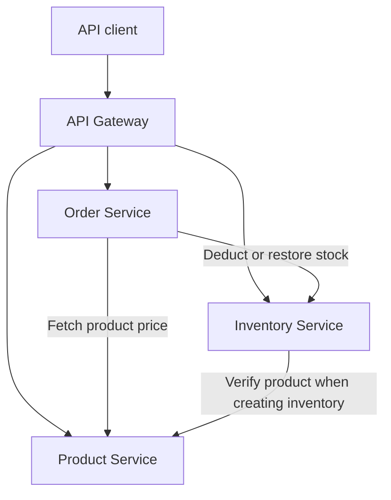

# E-Commerce Microservices Backend

A Java and Spring Boot backend for managing product categories, products, inventory, and orders. The project demonstrates synchronous service communication, service discovery, gateway routing, centralized configuration, and shared API contracts.

Built by [Faraz Ali](https://github.com/FarazAli-1).

## Contents

- [Features](#features)
- [Architecture](#architecture)
- [Technology stack](#technology-stack)
- [Repository layout](#repository-layout)
- [Local setup](#local-setup)
- [API reference](#api-reference)
- [Example workflow](#example-workflow)
- [Response format](#response-format)
- [Tests](#tests)
- [Implementation notes](#implementation-notes)

## Features

- Category CRUD and product CRUD, including product lookup by category.
- Inventory CRUD, stock additions, deductions, and restoration.
- Order creation with multiple items and paginated order listing.
- Product prices fetched by the Order Service and stored on order items at purchase time.
- Paginated product and inventory listings.
- Request validation using Jakarta Bean Validation.
- Shared response envelopes, pagination metadata, and exception handling.
- JPA auditing for creation and update timestamps.
- Optimistic locking on inventory records using `@Version`.
- Eureka service discovery and gateway routes using service names.
- Load-balanced REST calls through `RestTemplate`.
- Resilience4j circuit-breaker annotations on inventory calls and inventory-to-product verification.
- Best-effort stock restoration when an exception is caught during order persistence.

## Architecture



Eureka provides service registration and discovery. Spring Cloud Config supplies configuration to the three business services from a separate Git repository.

| Module | Responsibility | Configured port |
| --- | --- | --- |
| `api-gateway` | Routes product, category, inventory, and order requests | `8080` |
| `product-service` | Owns product and category data | `8081` |
| `inventory-service` | Owns stock quantities referenced by product ID | `8082` |
| `order-service` | Owns orders and their item/price snapshots | `8083` |
| `discovery-service` | Eureka registry | `8761` |
| `config-server` | Git-backed configuration server | `8888` |
| `ecommerce-shared` | Shared DTOs and exception handler; consumed as a library | — |

Business-service ports are defined in [ecommerce-configs-vault](https://github.com/FarazAli-1/ecommerce-configs-vault). Gateway, discovery, and Config Server ports are defined locally.

### Order placement

1. Validate the request and map its items to an order entity.
2. For each item, fetch the product through `product-service`.
3. Ask `inventory-service` to deduct the requested quantity.
4. Copy the current product price onto the order item.
5. Save the order and its items.
6. If an exception is caught around the save call, attempt to restore stock for every order item.

Transactions are local to each service. See [Implementation notes](#implementation-notes) for the limits of the compensation flow.

## Technology stack

| Technology | Usage |
| --- | --- |
| Java 17 | Language level configured in all module POMs |
| Spring Boot | Application framework; `4.0.6` in most modules, `4.1.0` in Config Server |
| Spring Cloud `2025.1.2` | Cloud dependency management in service modules |
| Spring Cloud Gateway Server Web MVC | Gateway routing |
| Netflix Eureka / Spring Cloud LoadBalancer | Service discovery and service-name REST calls |
| Spring Cloud Config | External configuration |
| PostgreSQL | Business-service persistence |
| Spring Data JPA / Hibernate | Repositories and entity persistence |
| MapStruct `1.5.5.Final` | Entity/DTO mapping in business services |
| Lombok | Generated accessors and constructors |
| Jakarta Bean Validation | Request constraints |
| Resilience4j | Circuit breakers and fallback methods |
| Maven | Independent module builds |
| JUnit 5 / Mockito | Application-context tests and inventory unit tests |

## Repository layout

| Directory | Contents |
| --- | --- |
| `api-gateway/` | Gateway application and local routing YAML |
| `config-server/` | Config Server application and Git backend settings |
| `discovery-service/` | Eureka Server application |
| `ecommerce-shared/` | `ApiResponse`, `PageResponse`, and `GlobalExceptionHandler` |
| `product-service/` | Category/product controllers, services, repositories, entities, and mappers |
| `inventory-service/` | Stock operations, product client, inventory persistence, and unit tests |
| `order-service/` | Order APIs, inventory client, order persistence, and mappers |
| `config-vault/` | Commented-out configuration examples |

Each application/library has its own `pom.xml` and Maven wrapper. There is no root aggregator POM.

## Local setup

### Prerequisites

- JDK 17.
- Maven 3.9+, or the Maven wrappers supplied in each module.
- A running PostgreSQL server and a database accessible to each business service.
- Network access to Maven Central and the Config Server's Git backend.

The commands below use Bash and installed Maven. To use a wrapper, run `bash mvnw` from the relevant module directory in place of `mvn`. On Windows, use `mvnw.cmd` from that directory.

### 1. Clone the repository

```bash
git clone https://github.com/FarazAli-1/ecommerce-microservices.git
cd ecommerce-microservices
```

### 2. Build the shared library

Run from the repository root:

```bash
mvn -f ecommerce-shared/pom.xml clean install
```

This installs the shared library in your local Maven repository so the business services can resolve it.

### 3. Configure PostgreSQL

The external configuration uses these environment variables in each business-service process:

| Variable | Value |
| --- | --- |
| `DB_URL` | PostgreSQL JDBC URL, such as `jdbc:postgresql://localhost:5432/product_db` |
| `DB_USERNAME` | PostgreSQL login |
| `DB_PASSWORD` | PostgreSQL password |

Create the databases and grant the configured user access before starting the services. Hibernate is configured with `ddl-auto=update`; it updates tables but does not create the PostgreSQL databases themselves.

The repository does not prescribe fixed database names. Separate databases such as `product_db`, `inventory_db`, and `order_db` are one local setup option; the actual isolation depends on the `DB_URL` supplied to each service.

### 4. Start discovery and configuration

Run each command from the repository root in a separate terminal, waiting for startup before proceeding:

```bash
mvn -f discovery-service/pom.xml spring-boot:run
```

```bash
mvn -f config-server/pom.xml spring-boot:run
```

The Config Server is configured to read the `main` branch of:

```text
https://github.com/FarazAli-1/ecommerce-configs-vault.git
```

The local `config-vault/` directory is not the configured backend. Business services import configuration through `optional:configserver:http://localhost:8888`; that optional import does not supply missing database settings when the server is unavailable.

### 5. Start the business services

Use a separate terminal for each service. Replace the sample credentials with your local PostgreSQL credentials.

Product Service:

```bash
export DB_URL='jdbc:postgresql://localhost:5432/product_db'
export DB_USERNAME='your_db_user'
export DB_PASSWORD='your_db_password'
mvn -f product-service/pom.xml spring-boot:run
```

Inventory Service:

```bash
export DB_URL='jdbc:postgresql://localhost:5432/inventory_db'
export DB_USERNAME='your_db_user'
export DB_PASSWORD='your_db_password'
mvn -f inventory-service/pom.xml spring-boot:run
```

Order Service:

```bash
export DB_URL='jdbc:postgresql://localhost:5432/order_db'
export DB_USERNAME='your_db_user'
export DB_PASSWORD='your_db_password'
mvn -f order-service/pom.xml spring-boot:run
```

For an IDE launch, put the same variables in each service's run configuration.

### 6. Start the gateway and check registration

```bash
mvn -f api-gateway/pom.xml spring-boot:run
```

- Eureka dashboard: `http://localhost:8761`
- Config lookup example: `http://localhost:8888/product-service/default`
- Product API through the gateway: `http://localhost:8080/api/product`

Wait for the business services to register with Eureka before calling the gateway. The gateway preserves the `/api/...` paths.

## API reference

Base URL through the gateway: `http://localhost:8080`.

### Categories

| Method | Path | Action |
| --- | --- | --- |
| POST | `/api/category` | Create category |
| GET | `/api/category` | List categories |
| GET | `/api/category/{id}` | Get category |
| PUT | `/api/category/{id}` | Update category |
| DELETE | `/api/category/{id}` | Delete category |

### Products

| Method | Path | Action |
| --- | --- | --- |
| POST | `/api/product` | Create product |
| GET | `/api/product?page=0&size=10` | List products with pagination |
| GET | `/api/product/{id}` | Get product |
| GET | `/api/product/category/{categoryId}` | List products in a category |
| PUT | `/api/product/{id}` | Update product name, description, and price |
| DELETE | `/api/product/{id}` | Delete product |

The product request DTO requires `categoryId` for both creation and update. The current update implementation does not change the product's category.

### Inventory

| Method | Path | Action |
| --- | --- | --- |
| POST | `/api/inventory` | Create inventory for a product |
| GET | `/api/inventory?page=0&size=10` | List inventory with pagination |
| GET | `/api/inventory/{id}` | Get inventory by inventory ID |
| PUT | `/api/inventory/{id}` | Replace stock quantity and product ID |
| DELETE | `/api/inventory/{id}` | Delete inventory by inventory ID |
| PUT | `/api/inventory/add-stock` | Add quantity to a product's stock |
| PUT | `/api/inventory/deduct-stock` | Deduct quantity from a product's stock |
| PUT | `/api/inventory/restore-stock` | Restore quantity to a product's stock |

Stock-operation bodies contain `productId` and `stockQuantity`. The request DTO requires a quantity of at least `1`, even for inventory creation/update. Successful deductions can leave stored stock at `0`.

### Orders

| Method | Path | Action |
| --- | --- | --- |
| POST | `/api/order` | Place an order |
| GET | `/api/order?page=0&size=10` | List orders with pagination |

Order creation currently returns HTTP `200`. Category, product, and inventory creation return HTTP `201`. Although the order service has a lookup-by-ID method, its controller does not expose a corresponding endpoint.

## Example workflow

Use Postman or another REST client. Send `Content-Type: application/json` for requests with a body. Substitute the IDs returned by your own requests; the example IDs below assume a fresh database.

### 1. Create a category

`POST http://localhost:8080/api/category`

```json
{
  "name": "Electronics",
  "description": "Computers and accessories"
}
```

### 2. Create a product

`POST http://localhost:8080/api/product`

```json
{
  "name": "Laptop",
  "description": "Laptop for development",
  "price": 150000.00,
  "categoryId": 1
}
```

Prices are numeric values; the API does not include a currency field.

### 3. Create inventory

`POST http://localhost:8080/api/inventory`

```json
{
  "productId": 1,
  "stockQuantity": 10
}
```

Inventory creation checks for existing inventory for the product and calls Product Service to verify the product.

### 4. Place an order

`POST http://localhost:8080/api/order`

```json
{
  "orderItems": [
    {
      "productId": 1,
      "quantity": 2
    }
  ]
}
```

The client supplies product IDs and quantities. Order Service fetches the prices itself. With the sample stock above, a successful purchase of two units leaves eight units in inventory.

### 5. Inspect the results

```text
GET http://localhost:8080/api/order?page=0&size=10
GET http://localhost:8080/api/inventory?page=0&size=10
```

## Response format

Controllers use the shared `ApiResponse` envelope:

```json
{
  "success": true,
  "message": "Product created successfully",
  "data": {
    "id": 1,
    "name": "Laptop",
    "description": "Laptop for development",
    "price": 150000.00,
    "categoryId": 1
  }
}
```

Paginated endpoints place a `PageResponse` inside `data`, with `content`, `page`, `pageSize`, `totalPages`, `totalElements`, `numberOfElements`, `first`, `last`, `hasNext`, and `hasPrevious`. Pages are zero-indexed.

The shared exception handler returns:

- HTTP `400` for request-body validation failures and handled runtime exceptions.
- HTTP `409` for handled optimistic-locking failures.

Handled error responses use `success: false`, an explanatory `message`, and `data: null`. Runtime exceptions for missing resources currently use HTTP `400` as well.

## Tests

The repository contains Spring Boot context-load tests and Mockito-based inventory tests for creation, duplicate inventory, stock additions, stock deductions, and insufficient stock.

After installing the shared library, run tests per module, for example:

```bash
mvn -f inventory-service/pom.xml test
```

Context-load tests may require configuration and database access. The current inventory tests need maintenance: the successful creation test does not mock the required `ProductClient`, and the duplicate-inventory assertion expects wording that differs from the implementation. The order context test also resides outside the application's package hierarchy.

## Implementation notes

- **Distributed consistency:** stock updates commit in Inventory Service independently of the order transaction. A failure on a later order item can leave earlier deductions in place. Restoration is attempted only inside the catch block around the repository save, can itself fail, and may not catch a failure raised at transaction commit. It is best-effort compensation rather than a complete saga.
- **Dependency alignment:** most modules declare Spring Boot `4.0.6`, while Config Server declares `4.1.0`. Order and inventory also pin older AOP and circuit-breaker starter versions. Validate compatibility before relying on the startup commands.
- **Build/runtime verification:** these instructions were checked against source and configuration. A full build and end-to-end run were not verified during this documentation review because Maven Central was unreachable.
- **API scope:** the implementation covers catalog, stock, and orders. Authentication, customer accounts, carts, payment processing, asynchronous messaging, and Redis caching are outside the current implementation.
- **Deployment assets:** the repository currently has no Dockerfiles, Compose configuration, Kubernetes manifests, or GitHub Actions workflow.
- **Database configuration:** service data ownership is separate in code; physical database separation depends on the configured JDBC URLs. Inventory duplicate prevention currently includes an application-level check without a declared unique constraint on `productId`.
- **Configuration:** the active Config Server backend is the external Git repository. Gateway routes are configured locally, and the local `config-vault/` examples are commented out.

Potential next steps include reliable stock compensation, idempotent order placement, dependency alignment, maintained tests, authentication, and automated deployment.
